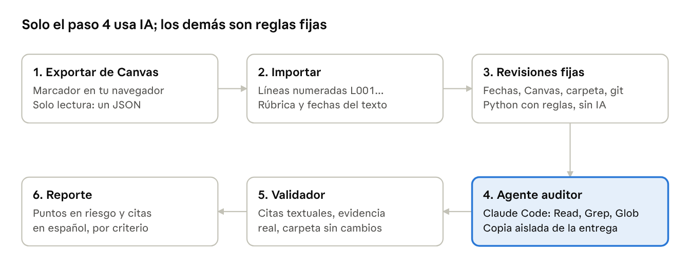

# Informe: Pre-flight, Proyecto 3

Fabian Prado. Inteligencia Artificial, UVG. 18 de noviembre de 2026.

Pre-flight revisa una entrega contra las instrucciones de Canvas antes de enviarla y dice
qué puntos se perderían, citando la instrucción en la que se basa. No hace la tarea: solo
la audita. Cómo reproducirlo está en el [README](../README.md).

## 1. Tarea elegida

Es la tarea 1 de mi [lluvia de ideas](../lluvia-de-ideas.md).

Elegí esta tarea ya que de las 5 estaba entre dos: esta y búsqueda de trabajo. A pesar de
eso, tomando en cuenta que esta tarea podría facilitar y optimizar de gran manera mis
entregas universitarias, y tomando en cuenta que ya trabajo y revisar si me faltó algo de
mis tareas me consume más tiempo de lo que tengo, decidí obviar la búsqueda de trabajo,
aunque lo dejé en mis notas para, en el momento que lo necesite, crearlo. Las demás no me
convencían tanto.

## 2. Por qué esta herramienta

Decidí usar Claude Code porque pago la suscripción Pro y ya trabajo en este entorno, lo que
me llevó a elegirlo. Pero decidí usar Opus en vez de Sonnet por su razonamiento.

## 3. Cómo funciona

Solo el paso 4 usa IA. Los demás son reglas fijas en Python: exportar la tarea desde
Canvas con un marcador del navegador, numerar las instrucciones, revisar fechas y git, y
validar que cada cita del agente sea textual y que la carpeta no haya cambiado.

## 4. Resultados de las pruebas

Siete casos reales, dos corridas cada uno. Las expectativas se subieron a git antes de
correr (commit 5a2e087) y los resultados después (commit f13e914). Se cumplieron 38 de 40.

| Caso | Lo que pasó de verdad | Lo que dijo el pre-flight |
|---|---|---|
| Laboratorio 6 | Nunca se entregó | Todo en falta, carpeta inexistente |
| Evaluaciones de Proyecto 2 | Nunca se entregó | Todo en falta, plantilla adjunta sin leer |
| Hoja de notas 4, 6 y 7 | Nunca se entregó; la instrucción es una línea | Un solo criterio en falta, sin inventar más |
| Proyecto 2 | El profesor no señaló faltantes | 0 de 100 puntos en riesgo; un commit 49 minutos después de la fecha |
| Hoja de trabajo 2 | Se restó por no explicar el método del codo; faltaba el link al Colab | Vio el Colab; dio el codo por cumplido |
| Proyecto 3 | En curso | Exploración y reflexión faltantes, fecha del 11 de noviembre |
| Proyecto 2 sin README | Copia modificada a propósito | Detectó el README faltante |

Detalle y los 14 reportes: [casos/resultados.md](../casos/resultados.md).

## 5. Errores encontrados

- **Método del codo:** la instrucción solo pedía "qué se puede ajustar y qué efecto tiene".
  La presentación nombraba el codo sin explicarlo y el agente lo dio por cumplido.
- **Una nota pendiente:** la presentación entregada tenía "TODO 4.4" en las notas del orador
  y el agente no lo marcó.
- **Formato:** en 2 de 14 corridas el validador atrapó citas armadas con pedazos de una línea
  y un "archivo de evidencia" que no era un camino.
- **Variación:** con la misma entrada, Proyecto 3 dio 80 y 78 puntos en riesgo.

Por qué creo que falla: falla en los casos donde el profesor menciona cosas durante la clase
sobre la entrega o tiene preferencias que no están explícitas en las tareas. Para esos casos
sería bueno introducir una sección de consideraciones por curso/tarea para que el agente lo
tome en cuenta.

## 6. Tiempo ahorrado

A mano, revisar una tarea contra su rúbrica me toma de 30 a 45 minutos, dependiendo de la
cantidad de secciones que tenga una tarea, y puede ser hasta más cuando suben PDFs confusos
con muchas secciones y redacción extraña.

| | Minutos |
|---|---|
| A mano, por tarea | 30 a 45 |
| Con pre-flight, por tarea: exportar, auditar (22 a 222 s) y leer el reporte (se supone unos 5) | 10 o menos |
| Ahorro por tarea | 20 a 35 |
| Configuración (16 y 18 de noviembre, según los commits) | unos 180 |

La configuración se recupera después de 6 a 9 tareas. Este curso tuvo 25 tareas en Canvas
este semestre.

## 7. Reflexión: la IA frente a los humanos

**En qué se parece.** Al final de cuentas, la IA tiene como entrenamiento y validación
ciertas cosas que la impulsan a revisar como ser humano. Además, revisar no es determinista,
y la IA tampoco: un auxiliar o profesor puede tener criterios distintos por entrega y es
normal. Lo bueno de la IA es que no conoce a la persona, por lo que no tendrá preferencias.

**En qué no se parece.** Continuando con el punto anterior, no conoce a las personas: no
sabe si nunca fue a la clase, si no ponía atención, o si su trabajo puede estar bien hecho
pero 100% IA, y el profesor lo sabría inmediatamente al conocer al estudiante, mientras que
la IA no.

**Implicaciones.** No me conecté a la API de Canvas por las razones mencionadas del token.
Únicamente creé la versión 1 para que cada persona pueda modificarlo en base a sus
preferencias. Si se equivoca, el estudiante es el que pierde puntos, por lo que considero
que el profesor debería tener un agente como este en el curso para que los estudiantes
puedan usarlo como un linter, pero de su entrega completa y no solo de su código.

**Qué dejé de hacer.** Dejé de revisar a mano la rúbrica antes de entregar. Está bien
delegarlo porque yo estoy propenso a tomar mi lado.

**Qué trabajos o habilidades cambian.** Estudiantes, uno por curso; auxiliares, igual, uno
por curso; el profesor podría crear uno para que todos lo usen como linter.

## 8. Datos que salieron de la máquina

- A Anthropic, en cada auditoría: la copia de la entrega, el texto extraído de sus
  documentos y las instrucciones.
- No salieron: notas, comentarios del profesor ni archivos ocultos o con secretos.
- De Canvas: los datos salieron de mi sesión del navegador, porque UVG no permite que los
  estudiantes creen tokens de la API.

## Uso de IA

Mis respuestas, dadas en una entrevista, son las secciones 1 y 2, el párrafo de por qué
creo que falla (sección 5), el tiempo a mano (sección 6) y toda la sección 7. Se pasaron al
informe sin cambiar su contenido: solo se corrigieron acentos y errores de escritura, y la
sección 2 se tradujo del inglés. El código, el README, las descripciones técnicas de las
secciones 3 a 5, las tablas y la sección 8 se hicieron con Claude Code.
